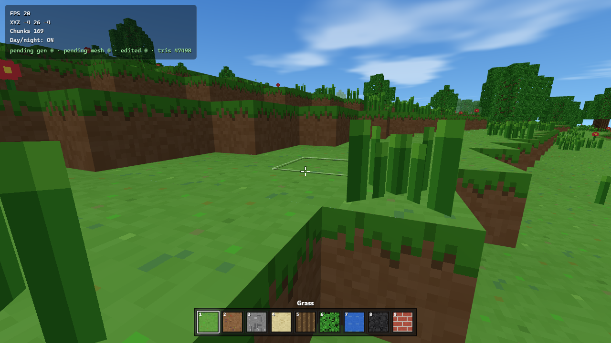

# TryMC — Voxel Sandbox

A browser-based voxel sandbox game built with **Three.js** and **TypeScript**:
procedurally generated terrain, first-person controls, block building, and
streaming 16×16×64 chunks. Runs entirely in the browser — no server-side
world, no assets to download, just a canvas and a pointer lock.

<picture>
  
</picture>

## Prerequisites

- **Node.js 20+** and **npm** (Vite 6 requires Node 18+; 20+ is recommended).
- A modern browser with **WebGL** support (Chrome, Edge, Firefox, Safari).

## Installation

```bash
npm install
```

## Development

```bash
npm run dev
```

Starts the Vite dev server (default port **5173**, see `vite.config.ts`). Open
the printed URL, click the canvas to enter pointer lock, and play.

All game logic is pure TypeScript with hot module reload; no external assets
are loaded — the texture atlas is generated procedurally on a canvas.

## Test commands

```bash
npm test
```

Runs the Vitest unit suite (`vitest.config.ts`, `node` environment, include
pattern `tests/**/*.test.ts`). Covers deterministic logic: seeded noise and
RNG, terrain generation, chunk/coordinate conversion, block registry, greedy
meshing-adjacent chunk behavior, voxel raycasting, hotbar selection, player
collision/physics, and in-session edit persistence.

```bash
npm run test:e2e
```

Runs the Playwright browser suite (`tests/e2e/*.spec.ts`, see
`playwright.config.ts`). It boots the dev server and the production build,
then verifies the game initializes, the canvas renders pixels, pointer lock
engages, movement/gravity/collision work, blocks can be targeted/placed/removed,
hotbar selection works, chunks stream in and out, and the production bundle
loads with zero console errors. Requires a one-time setup:

```bash
npx playwright install chromium
```

## Lint command

```bash
npm run lint
```

Runs ESLint 9 (flat config, `eslint.config.js`) over the whole project.

## Type-check command

```bash
npm run typecheck
```

Runs `tsc --noEmit` with the strict compiler options in `tsconfig.json`.

## Production build

```bash
npm run build
```

Runs `tsc` (type-check) followed by `vite build`, emitting the production
bundle to `dist/`.

## Preview / deployment

```bash
npm run preview
```

Serves the production build from `dist/` locally (this is `vite preview`).
To deploy, upload the `dist/` directory to any static host — the build uses
`base: "./"`, so it works from any sub-path.

## Controls

| Input              | Action                                              |
| ------------------ | --------------------------------------------------- |
| Click              | Enter pointer lock (mouse look)                     |
| `W` / `A` / `S` / `D` | Move forward / left / back / right              |
| `Space`            | Jump (swim up when in water)                        |
| `Shift`            | Sprint (faster, wider FOV)                          |
| Mouse              | Look around                                         |
| Left click         | Break the targeted block                            |
| Right click        | Place the selected block                            |
| `1` – `9`          | Select hotbar slot (also the scroll wheel)          |
| Scroll wheel       | Cycle hotbar selection                              |
| `N`                | Toggle the day/night cycle                          |
| `F3`               | Toggle the debug overlay (HUD)                      |

## How it works / Architecture

The world is a grid of **16×16×64 chunks** streamed in a spiral around the
player. Key pieces:

- **Greedy-meshed chunks** — `src/world/Mesher.ts` builds each chunk's faces
  by 2D masks per direction and merges runs of identical texture into single
  quads (a merged quad can span a whole chunk). Face UVs are computed per
  block in the fragment shader (`src/render/voxelShader.ts`), so merged quads
  tile correctly instead of stretching across the atlas. Faces go into three
  passes: **solid** (opaque), **cutout** (leaves and plants, `alphaTest` +
  `DoubleSide`), and **water** (translucent, sunken surface, rendered last).
  Per-face brightness and merged-corner ambient occlusion are baked into
  vertex colors.
- **Procedural seeded terrain** — `src/world/TerrainGenerator.ts` generates
  deterministic terrain from a seed: broad continents and rolling hills with
  a ridged mountain mask, stone and snow caps, cliff-sealed caves, beaches,
  and forest-clumped oak/spruce trees with canopies that overhang neighboring
  chunks. Tall grass and flowers dot the grassland. Bedrock sits at `y = 0`.
- **Chunk streaming** — `src/world/ChunkManager.ts` keeps generation and
  meshing inside per-frame time budgets (6 ms each), rebuilds only dirty
  chunks, marks boundary neighbors dirty on edits, and unloads far chunks
  once per simulated second.
- **AABB collision** — `src/player/PlayerController.ts` integrates movement
  axis-by-axis against the voxel grid (half-width 0.3, height 1.8), with
  gravity, jump, sprint, water buoyancy/swimming, one-block auto step-up,
  head bob, and an FOV kick.
- **Voxel raycasting** — `src/player/BlockPicker.ts` is an Amanatides & Woo
  grid DDA that returns the first non-air block hit and its face normal
  (used for both breaking and placing); the cell containing the eye is
  skipped so targeting works while swimming.
- **Sky and lighting** — `src/render/SkyDome.ts` draws a gradient sky with a
  sun halo, moon, stars and drifting clouds; `src/render/WorldRenderer.ts`
  animates the day/night cycle and matches fog to the horizon.
- **In-session edit persistence** — player block edits are recorded as an
  overlay map (`ChunkManager.edits`) and re-applied when a chunk is
  regenerated, so edits survive chunk unload/reload.

The **`openspec/`** directory holds the formal design specification, capability
specs, architecture decision records, and change records (see the index at the
end of this file).

## Configuration

- **URL parameter `?seed=N`** — set the world seed. Example:
  `http://localhost:5173/?seed=42`. Defaults to `1337` when omitted.
- **Constants** in `src/Constants.ts`:

  | Constant        | Value | Meaning                                   |
  | --------------- | ----- | ----------------------------------------- |
  | `CHUNK_SIZE`    | 16    | Chunk edge length (blocks)                |
  | `CHUNK_HEIGHT`  | 64    | Chunk height (blocks)                     |
  | `SEA_LEVEL`     | 22    | Water surface height                      |
  | `VIEW_RADIUS`   | 6     | Chunk streaming radius around the player  |
  | `MAX_REACH`     | 6     | Max distance (blocks) you can break/place |

## Performance notes

- **Generation budget:** 6 ms of chunk generation per frame, and a separate
  6 ms of mesh rebuilding per frame (`ChunkManager.update`). These are the
  code's per-frame limits; work is spread across frames so the main loop never
  blocks on a large burst.
- **Measured (headless Chromium, `?seed=1337`, VIEW_RADIUS=6):**
  with all 169 chunks loaded and the generation/mesh queues drained, the game
  renders **~47,000 triangles** with **0 pending generation and 0 pending
  mesh** work. Observed frame rate in software-rendered headless Chromium is
  ~20 FPS; on real GPU hardware expect a stable frame rate — on your GPU
  results will vary.
- **Interleaving:** generation and meshing are spread across frames so the
  main loop never blocks on a large burst of work.
- The world is fully procedural — no out-of-memory assets, and the texture
  atlas is a single 14-tile canvas with nearest-neighbor filtering.

## Known limitations

- **No persistence across browser restarts** — the world regenerates from the
  seed on every load; block edits survive chunk unload/reload in-session but
  are not saved to disk/storage.
- **No audio** — the game is completely silent (no music or sound effects).
- **No multiplayer / networking** — single-player only; no server component.
- **No crafting, item drops, health, hunger, or inventory beyond the fixed
  9-slot hotbar** — block selection and placement are the interaction scope.
- **Water has no physics** — it is a non-solid translucent block; swimming is a
  simplified buoyancy, not fluid simulation.
- **Leaves and water are single-block materials** — no per-block metadata,
  growth, or decay; breaking a leaf block does not affect neighboring leaves.
- **Day/night cycle is cosmetic** — time advances in the renderer only and does
  not affect gameplay.

## OpenSpec documentation index

| Document | Purpose |
| -------- | ------- |
| `openspec/project.md` | Project overview, tech stack, module map |
| `openspec/architecture.md` | Architecture, data flows, chunk lifecycle, determinism |
| `openspec/acceptance-criteria.md` | 81 testable acceptance criteria by capability |
| `openspec/verification-matrix.md` | Requirement-to-implementation traceability |
| `openspec/specs/rendering/spec.md` | Rendering capability spec |
| `openspec/specs/world-generation/spec.md` | Terrain generation capability spec |
| `openspec/specs/chunk-streaming/spec.md` | Chunk lifecycle / streaming spec |
| `openspec/specs/player-controller/spec.md` | Movement, physics, collision spec |
| `openspec/specs/block-interaction/spec.md` | Raycasting, break/place spec |
| `openspec/specs/inventory/spec.md` | Hotbar capability spec |
| `openspec/specs/lighting/spec.md` | Lighting / environment spec |
| `openspec/specs/user-interface/spec.md` | HUD / UI spec |
| `openspec/specs/performance/spec.md` | Performance targets and budgets |
| `openspec/decisions/ADR-001-…-004` | Architecture decision records |
| `openspec/changes/CHANGE-001…002` | Change records (proposal/design/tasks/spec-delta/verification) |